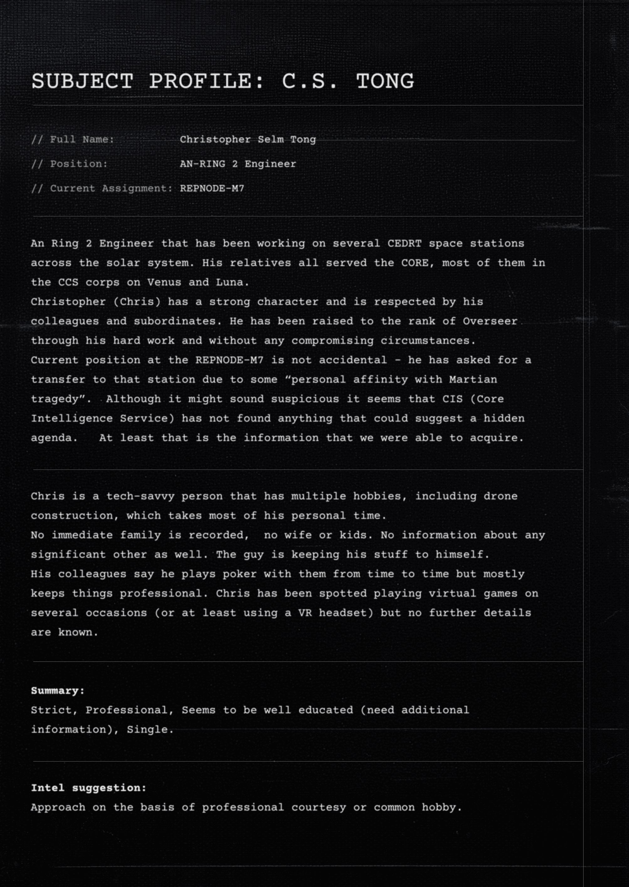

# C.S.Tong 档案（Dossier C.S.Tong）

- 分类：Entry 3: The Way
- 类型：IMAGE
- entryId：019dc0d4-dfa0-7662-96df-c3e94989e1f4
- 配图：../../img/737934030AE165D0.png

---

## 图片文字（中文翻译）

> 由配图转录并翻译；原文为英文，专有名词保留原文拼写

**SUBJECT PROFILE: C.S. TONG（对象档案：C.S. TONG）**

// 全名：Christopher Selm Tong
// 职务：AN-RING 2 工程师（AN-RING 2 Engineer）
// 当前派驻：REPNODE-M7

一名 Ring 2 工程师，一直辗转于太阳系内的多座 CEDRT 空间站工作。他的亲属全都曾为 CORE 效力，其中大多数人在金星与月球上的 CCS 部队服役。

Christopher（Chris）性格刚强，受到同事与下属的尊敬。他凭借勤奋工作、且未经历任何有污点的情形，被提升至 Overseer（监督官）军衔。

他目前在 REPNODE-M7 任职并非偶然——他是主动申请调往该站的，理由是某种“对火星悲剧的个人情感牵连”。尽管这听起来可疑，但 CIS（Core Intelligence Service，核心情报局）似乎并未发现任何能表明他另有隐秘目的的东西。至少，这是我们所能获取到的情报。

Chris 是个技术型的人，爱好众多，其中包括无人机制造，这占据了他绝大部分私人时间。

档案中没有直系亲属记录，没有妻子、也没有孩子。同样没有任何关于伴侣的信息。这家伙把自己的事捂得很严。

据同事说，他不时会和他们打扑克，但大体上保持公事公办。Chris 曾多次被人看到在玩虚拟游戏（或至少是在使用 VR 头显），但没有更多细节可知。

**摘要（Summary）：**

严格、专业、似乎受过良好教育（需补充情报）、单身。

**情报建议（Intel suggestion）：**

以职业礼节或共同爱好为切入点进行接触。
