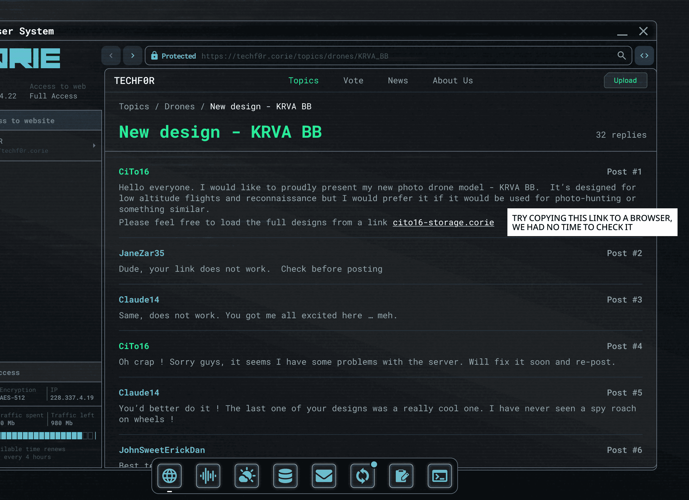

# 论坛截图（Forum screenshot）

- 分类：Entry 3: The Way
- 类型：IMAGE
- entryId：019dc0d4-dfa0-778a-8e23-e9217c4ea915
- 配图：../../img/323147791FD734B4.png

---

## 图片文字（中文翻译）

> 由配图转录并翻译；原文为英文，专有名词保留原文拼写

**浏览器窗口（标题栏／地址栏）**

- 窗口标题：`…er System`（左端被窗口边缘裁切，[无法辨认] 完整词）
- 地址栏：`Protected` 🔒 `https://techf0r.corie/topics/drones/KRVA_BB`（加锁标记：受保护连接）
- 顶部导航：`TECHF0R`｜`Topics`｜`Vote`｜`News`｜`About Us`｜按钮 `Upload`
- 面包屑：`Topics / Drones / New design - KRVA BB`
- 帖子标题：`New design - KRVA BB`（新设计 - KRVA BB）
- 标题右侧：`32 replies`（32 条回复）

**左侧信息面板**（整列左缘被窗口裁切）

- 标题：`…ss to website`（部分被裁）
- 域名行：`…r` / `…techf0r.corie`
- 面板标题：`…ccess`
- `Encryption / AES-512`（加密方式：AES-512）
- `IP / 228.337.4.19`
- `Traffic spent / 0 Mb`（已用流量 0 Mb）
- `Traffic left / 980 Mb`（剩余流量 980 Mb）
- `…ilable time renews every 4 hours`（可用时长每 4 小时续期一次）
- 下方为一排方格状流量进度条，末尾两格为虚线空框
- 面板上方另有：`Access to web` / `4.22  Full Access`（完全访问权限）

**论坛帖子区**

- `Post #1`　**CiTo16**
  大家好。我要自豪地展示我新的摄影无人机型号——KRVA BB。它是为低空飞行与侦察而设计的，不过我更希望它被用于摄影狩猎之类的事。欢迎从链接 cito16-storage.corie 下载完整设计图。
- `Post #2`　**JaneZar35**
  老兄，你的链接打不开。发帖前先检查一下。
- `Post #3`　**Claude14**
  一样，打不开。你把我胃口都吊起来了……唉。
- `Post #4`　**CiTo16**
  糟糕！抱歉各位，看来我服务器出了点问题。我会尽快修好并重发。
- `Post #5`　**Claude14**
  你最好真修好！你上一个设计真的很酷。我还从来没见过带轮子的间谍蟑螂！
- `Post #6`　**JohnSweetErickDan**
  `Best ta…`（正文被底部任务栏遮挡，其余 [无法辨认]）

**右上贴纸便签**

- `TRY COPYING THIS LINK TO A BROWSER, WE HAD NO TIME TO CHECK IT`
  （试着把这个链接直接复制到浏览器里打开，我们没时间核实它）

**屏幕底部**

- 任务栏上有一排圆形／方形图标按钮（地球仪、声波、灯泡、数据库、信封、刷新箭头、编辑、终端提示符），最左的地球仪按钮下方带一个小横线，刷新箭头按钮右上角有一个小圆点提示。
