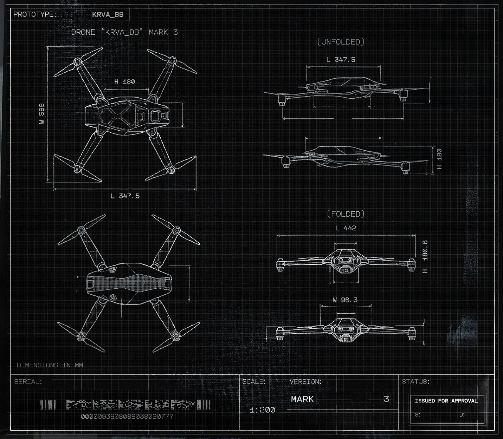

# KRVA_BB.eb52x

- 分类：Entry 3: The Way
- 类型：IMAGE
- entryId：019dc0d4-dfa0-79b6-9e47-f35f42b0d926
- 配图：../../img/8DC73484A5527BDC.jpg

---

## 图片文字（中文翻译）

> 由配图转录并翻译；原文为英文，专有名词保留原文拼写

这是一张黑底白线的无人机三视图工程图（网格纸背景），图上文字如下。

**图头与图名**

- 左上方框：`PROTOTYPE:` → `KRVA_BB`（原型机：KRVA_BB）
- 图名：`DRONE "KRVA_BB" MARK 3`（无人机“KRVA_BB”，MARK 3）

**视图标注**

- 左上图（整机立体视角）：`H 180`（高 180）、`L 347.5`（长 347.5）；左侧竖排 `W 566`（宽 566）
- 右上图（侧视轮廓）：`〔UNFOLDED〕`（展开状态）、`L 347.5`（长 347.5）、`H 180`（高 180）
- 右中图（俯视轮廓）：`〔FOLDED〕`（折叠状态）、`L 442`（长 442）、`H 180.6`（高 180.6）
- 右下图（正视轮廓）：`W 96.3`（宽 96.3）
- 图面左下角：`DIMENSIONS IN MM`（尺寸单位为毫米）

**图签栏（底部）**

- `SERIAL:`（序列号）—— 点阵状条码图形，其下数字：`0000093908088038020777`
- `SCALE:`（比例）`1:200`
- `VERSION:`（版本）`MARK` `3`
- `STATUS:`（状态）`ISSUED FOR APPROVAL`（已签发待批准），其框内下方为 `S:` 与 `D:`
