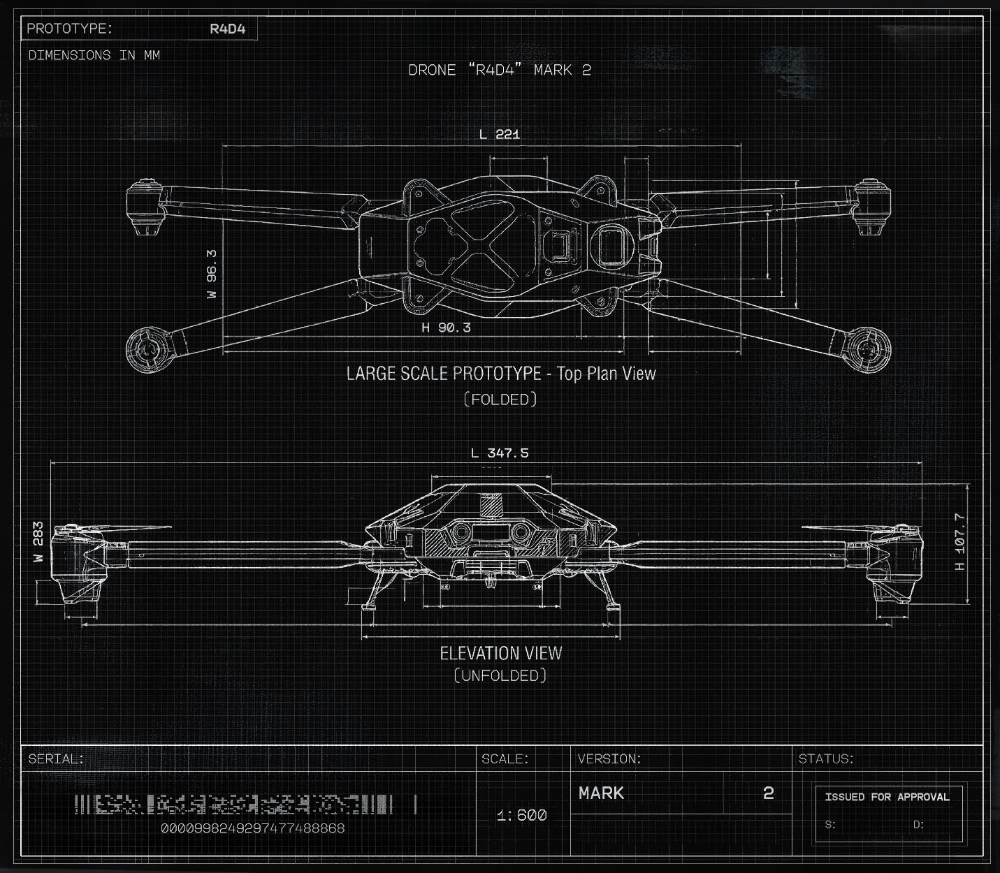

# 螳螂无人机 R4RD（Tong）（Mantis drone R4RD）

- 分类：Entry 3: The Way
- 类型：IMAGE
- entryId：019dc0d4-dfa0-7a7d-b532-a9f2915ee387
- 配图：../../img/F889BECA8AC9D36B.jpg

---

## 图片文字（中文翻译）

> 由配图转录并翻译；原文为英文，专有名词保留原文拼写

这是一张黑底白线的无人机工程图（网格纸背景），上方为俯视图、下方为正视图，图上文字如下。

**图头与图名**

- 左上方框：`PROTOTYPE:` → `R4D4`（原型机：R4D4）
- 其下：`DIMENSIONS IN MM`（尺寸单位为毫米）
- 图名：`DRONE "R4D4" MARK 2`（无人机“R4D4”，MARK 2）

**视图标注**

- 上方俯视图：`L 221`（长 221）、左侧竖排 `W 96.3`（宽 96.3）、`H 90.3`（高 90.3）
- 俯视图下方说明：`LARGE SCALE PROTOTYPE - Top Plan View`（大比例原型机——俯视图），下一行 `〔FOLDED〕`（折叠状态）
- 下方正视图：`L 347.5`（长 347.5）、左侧竖排 `W 283`（宽 283）、右侧竖排 `H 70.7`（高 70.7）
- 正视图下方说明：`ELEVATION VIEW`（正视图／立面图），下一行 `〔UNFOLDED〕`（展开状态）

**图签栏（底部）**

- `SERIAL:`（序列号）—— 点阵状条码图形，其下数字：`0000998249297477488868`
- `SCALE:`（比例）`1:600`
- `VERSION:`（版本）`MARK` `2`
- `STATUS:`（状态）`ISSUED FOR APPROVAL`（已签发待批准），其框内下方为 `S:` 与 `D:`

注：图面机型号写作 `R4D4`（与文件名 R4RD 不同），此处按图上实际字样转录。
