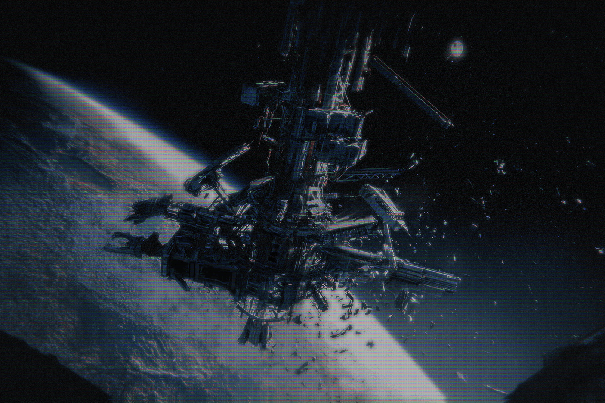

# 新闻简报 #5（News Bulletin #5）

- 分类：News
- 类型：IMAGE
- entryId：019d5d98-f5d1-714e-863b-010e9918d505
- 配图：../../img/D63E27FA2FFD196D.png

---

**“天梯”**

今天是“漂浮升降舱”脱离六周年 —— 它是天梯（Sky Lift）的一部分，已从其行星基座上脱落。科学家仍在持续监测它的轨道，现已确认它很可能会留在太阳系内。

尽管该物体本身被认定对任何殖民地或大型空间站都不构成危险，但它的自转仍有些难以预测，这意味着其运行路径上的任何较小空间站或卫星都可能面临严重危险。
